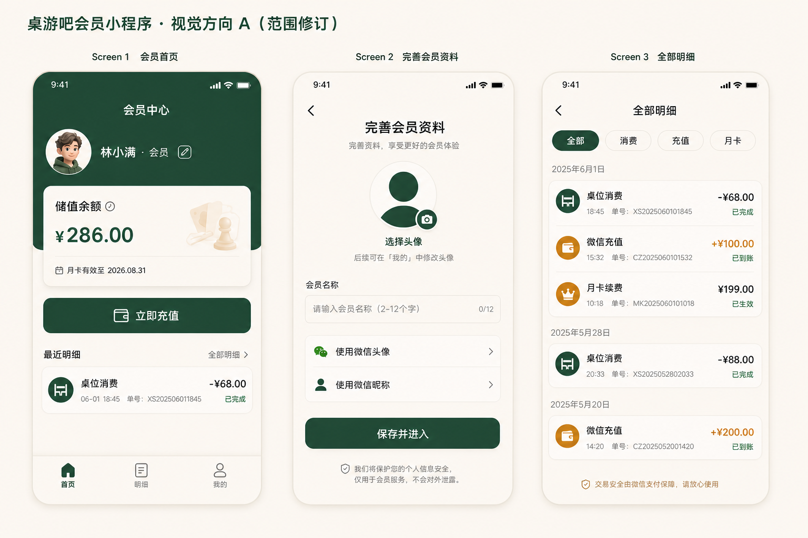

# 小程序会员充值体验与 PC 交易记录设计

> 决策日期：2026-07-25
>
> 状态：视觉方向已确认，等待书面规格复核
>
> 适用范围：微信小程序会员端、云端会员与交易投影、PC 端交易记录
>
> 环境约束：除数据库使用隔离测试库外，登录、HTTPS、微信支付和服务端结算均按生产方式运行

## 1. 目标

本轮交付一个可供真实小额支付测试的会员小程序初版，并补齐 PC 端跨会员查看消费单和充值单的能力。

完成后应满足：

1. 新微信用户授权手机号后，可以设置会员名称和头像，再进入会员中心。
2. 已注册会员可以修改名称和头像，修改结果同步到数据库并在后续登录时保持一致。
3. 小程序仅提供会员资料、余额、月卡、历史明细和在线充值。
4. 用户明确取消微信支付后，页面不再显示该笔待支付充值卡片。
5. 一次储值消费在小程序最近明细中只显示一次“桌位消费”，不会再额外显示“订单 xxxx 储值支付”。
6. PC 端提供全店交易记录，可以分别查看消费单和充值单。
7. 小程序完成的微信充值可以在 PC 端充值单中查询和查看详情。
8. 底层消费单、充值单和余额流水仍分别保留并通过稳定标识关联，展示去重不删除财务记录。

## 2. 已确认的产品决策

### 2.1 视觉方向

采用视觉方向 A：

- 深森林绿作为主色。
- 温暖奶油白作为页面和卡片底色。
- 焦糖金只用于充值、到账和月卡等强调信息。
- 使用克制的圆角、轻阴影和简洁线性图标。
- 移除首页顶部的门店名称与运营状态卡片。

确认稿：

门店 Logo 不是本轮开发前置条件。后续收到透明底 PNG 或 SVG 后，可替换文字标识和默认头像装饰，不改变页面结构。

### 2.2 当前功能边界

小程序当前只保留：

- 微信登录和手机号授权。
- 首次会员资料完善。
- 会员资料查看与修改。
- 储值余额和月卡状态查询。
- 消费、充值和月卡历史查询。
- 真实微信支付充值。

明确不包含：

- 会员码、二维码或“出示会员码”。
- “开桌”、预订、扫码开台或桌位操作。
- 活动入口和公开活动页。
- 店员、店长、移动收银和移动管理功能。
- 首页门店营业状态卡片。
- “在线充值体验”演示区域。
- 微信退款、充值撤销和店员端充值操作。

仓库中已有的未来功能代码可以保留，但不得出现在当前小程序导航、首页快捷入口或自动跳转流程中。

## 3. 方案选择

### 3.1 小程序页面组织

采用三入口结构：

- **首页**：会员摘要、余额、月卡、充值入口和最近明细。
- **明细**：统一业务明细列表，支持全部、消费、充值和月卡筛选。
- **我的**：会员名称、头像和账号资料维护。

未采用的方案：

- 把所有内容继续堆在会员中心长页面：开发改动较少，但现有页面已经出现错位、信息拥挤和充值操作重复。
- 增加会员码或开桌作为首页主操作：超出当前业务范围，且会让测试人员误认为功能已经可用。

### 3.2 重复明细处理

采用“统一业务活动投影 + 显式关联”方案：

- 消费订单是面向会员展示的业务事件。
- 余额扣款是该订单的账本结果。
- 当余额扣款已通过订单 ID、来源操作 ID 或事件载荷与消费订单关联时，最近明细只展示消费订单。
- 账本流水继续保留在数据库和 PC 端对账详情中。

未采用的方案：

- 直接删除余额扣款流水：会破坏财务审计和余额可追溯性。
- 根据文案“订单 xxxx 储值支付”或相近时间猜测去重：历史文案可能变化，并发订单也可能误匹配。

### 3.3 PC 端查询入口

采用新的一级入口“交易记录”，包含：

- **消费单**：全店消费订单。
- **充值单**：全店现金充值和微信充值订单。

现有“储值账户”继续用于选择会员后查看余额、账本流水和执行有权限的人工操作，不再承担全店单据查询职责。

未采用的方案：

- 把全店充值单继续放在单个会员的储值账户页面：必须先找到会员，无法满足全店查询和对账。
- 只从钱包流水推断充值单：缺少支付状态、商户订单号、微信支付单号和失败原因等订单信息。

## 4. 小程序交互设计

### 4.1 登录与首次资料完善

1. 游客进入小程序时只看到登录引导，不生成固定测试会员，也不自动绑定虚拟手机号。
2. 用户主动触发微信手机号授权。
3. 服务端通过真实微信凭证完成登录或创建会员。
4. 新会员或缺少有效名称的会员进入“完善会员资料”页。
5. 用户必须填写会员名称；头像可以选择微信头像或暂时使用默认头像。
6. 页面提供微信原生的头像选择和昵称填写能力，但不能静默读取微信头像或昵称。
7. 保存成功后刷新会员摘要并进入首页。

会员名称规则：

- 去除首尾空格。
- 长度为 2 至 12 个可见字符。
- 不允许只包含空白字符。
- 不把手机号、OpenID 或固定测试账号作为默认会员名称。

头像规则：

- 接受微信头像选择器返回的临时文件。
- 上传成功后只保存服务端返回的受控资源地址。
- 上传失败时保留原头像，不提交无效地址。
- 没有头像时使用统一默认头像。

### 4.2 资料修改

“我的”页面提供编辑入口：

- 修改会员名称。
- 重新选择头像。
- 保存时显示明确的进行中状态，防止重复提交。
- 服务端校验当前会员身份，只允许修改自己的资料。
- 保存成功后同步刷新首页头像、名称和数据库记录。
- 保存失败时保留用户输入并显示可重试提示。

### 4.3 首页

首页按确认稿组织：

1. 页面标题“会员中心”。
2. 头像、会员名称和编辑入口。
3. 储值余额卡片。
4. 月卡有效期或“未开通月卡”状态。
5. 唯一主操作“立即充值”。
6. 最近明细，默认显示最近若干条统一业务事件。
7. 底部导航只有“首页 / 明细 / 我的”。

首页不得出现：

- 门店名称和运营状态卡片。
- 会员码按钮。
- 开桌按钮或骰子图标。
- 店员、店长、活动和内容管理入口。
- “在线充值体验”文案或演示充值档位。

### 4.4 全部明细

“全部明细”使用独立页面，不再跳转到包含充值控件的旧会员中心长页面。

页面提供：

- “全部 / 消费 / 充值 / 月卡”筛选。
- 按日期分组。
- 左侧显示业务类型、标题、时间和单号。
- 右侧显示金额和状态。
- 消费金额显示为负数，充值到账显示为正数，月卡按业务语义显示金额和状态。
- 列表项可以进入只读详情。

全部视图的每一行代表一个会员能理解的业务事件。消费订单使用余额支付时，只显示“桌位消费”，不会再同时显示对应的余额扣款文案。

### 4.5 充值与取消支付

充值流程：

1. 用户选择正式充值档位或测试环境专用的 0.01 元档位。
2. 小程序向服务端创建充值订单。
3. 服务端返回真实微信 JSAPI 支付参数。
4. 小程序调用 `wx.requestPayment`。
5. 支付完成后以服务端订单状态为准，只有 `settled` 才刷新余额和到账记录。

用户明确取消支付时：

- 立即关闭支付结果卡片并提示“已取消支付”。
- 首页和明细页不显示该笔 `pending_payment` 订单。
- 不在客户端删除或伪造服务端订单状态。
- 服务端仍负责查单、关单和超时处理。
- 如果取消后微信实际返回成功并由服务端结算，该笔充值按真实结果出现在充值历史中。

网络中断或微信返回结果不明确时，不按“用户取消”处理。页面显示“正在确认支付结果”，允许恢复网络后继续查询原订单，避免重复下单。

## 5. 业务单据与账本关系

系统区分三种记录：

- **消费单**：描述一次桌位或商品消费业务。
- **充值单**：描述一次现金或微信充值业务及支付状态。
- **余额流水**：描述本金、赠送余额和月卡权益的不可变增减。

展示规则：

- 小程序首页和全部明细展示消费单、已到账充值单和月卡业务事件。
- 与消费单关联的 `wallet.debited` 只作为账本结果，不重复进入小程序业务明细。
- PC 消费单详情可以查看支付方式和关联余额流水。
- PC 充值单详情可以查看本金、赠送额、到账额、支付渠道、状态和关联余额流水。
- 任何展示去重都不能删除、覆盖或合并底层账本行。

关联优先使用稳定字段：

1. 消费单或充值单 ID。
2. 钱包流水的来源操作 ID。
3. 云事件操作 ID。
4. 事件载荷中的结构化关联字段。

不使用名称、金额、文案和时间窗口作为主要关联依据。

## 6. 服务端接口与数据投影

### 6.1 会员资料

新增或补齐当前登录会员资料更新接口：

- 输入：会员名称、头像资源地址和幂等请求 ID。
- 身份：真实微信会员会话。
- 输出：更新后的会员自助摘要。
- 行为：数据库更新、审计记录和后续查询在同一会员上下文中保持一致。

头像上传使用受控上传流程。小程序不能把任意外部 URL 直接写入会员资料。

### 6.2 统一会员明细

会员历史接口返回可直接展示的业务活动，至少包含：

- 活动 ID。
- 活动类型：消费、充值或月卡。
- 业务单据 ID 和展示单号。
- 标题。
- 金额和金额方向。
- 状态。
- 发生时间。
- 可选的详情摘要。

服务端负责基于稳定关联关系消除“消费单 + 对应余额扣款”的展示重复。客户端只排序和渲染，不复制业务去重规则。

### 6.3 PC 充值单投影

微信充值订单需要形成 PC 可同步、可查询的充值单投影，不能只同步钱包增量。

充值单投影至少包含：

- 充值单 ID 和商户订单号。
- 门店和会员标识。
- 充值渠道：现金或微信。
- 本金、赠送金额和总到账金额。
- 状态：创建中、待支付、已到账、失败或已过期。
- 微信支付单号，未产生时为空。
- 创建、支付和结算时间。
- 关联钱包操作 ID。

PC 从该投影显示完整充值单；钱包流水仍通过现有增量事件合并，二者使用幂等 ID 关联，不能重复入账。

## 7. PC“交易记录”设计

### 7.1 消费单

默认按完成时间倒序，提供：

- 日期范围。
- 订单号。
- 会员名称或手机号后四位。
- 支付方式。
- 订单状态。

列表列项：

- 消费单号。
- 完成时间。
- 会员。
- 消费金额。
- 支付方式。
- 状态。

详情展示商品或桌位消费摘要、支付组成，以及关联的储值扣款流水。

### 7.2 充值单

默认按创建时间倒序，提供：

- 日期范围。
- 充值单号。
- 会员名称或手机号后四位。
- 渠道：现金或微信。
- 状态。

列表列项：

- 充值单号。
- 创建或到账时间。
- 会员。
- 本金。
- 赠送金额。
- 总到账金额。
- 渠道。
- 状态。

详情展示商户订单号、微信支付单号、结算时间和关联钱包流水。未支付、失败和已过期订单可以查询，但必须与已到账订单有明显状态区分，且不得计入到账统计。

### 7.3 收银主页手动刷新

PC“前台收银”页面顶端右侧新增“刷新”按钮，用于顾客当场完成手机充值后，收银员立即同步并查看最新余额。

按钮行为：

1. 调用现有的云端立即同步能力，不新增第二套同步协议。
2. 先上传本机待同步操作并查询处理结果，再拉取云端会员、钱包、月卡、消费单和充值单增量。
3. 同步完成后重新读取收银页的会员列表、最近订单，以及当前已选会员的余额和月卡。
4. 同时使“交易记录”页面能够读取刚同步的消费单和充值单。
5. 保留当前选中的会员、购物车、数量、备注和尚未提交的收银内容，不执行整页重载。

交互状态：

- 默认显示“刷新”。
- 同步过程中显示“同步中…”并禁用按钮，防止并发重复同步。
- 成功后显示“同步完成”，并标注本次同步完成时间。
- 若仍有等待云端处理的本机操作，明确显示剩余数量，不把它描述为全部完成。
- 失败时保留当前本地数据和未提交收银内容，显示网络或同步错误，并允许重试。
- 离线时手动刷新失败不影响现有离线收银能力。

现有后台自动同步继续保留。手动刷新只用于缩短现场等待时间，不替代自动同步，也不直接修改本地余额。

## 8. 错误处理

- 资料保存重复提交：以请求 ID 幂等处理，只产生一次更新。
- 头像上传成功但资料保存失败：保留旧资料并允许使用已上传资源重试。
- 微信支付取消：隐藏本地待支付展示，服务端订单继续正常查单和超时关单。
- 支付结果不明确：查询原订单，不重新创建充值单。
- 微信重复通知：只结算一次，只产生一组账本流水。
- PC 暂时离线：云端充值先完成，恢复连接后通过幂等投影和账本事件同步。
- 收银主页重复点击刷新：同一时间只运行一次同步，不启动并发同步任务。
- 收银主页刷新失败：不清空购物车、当前会员或本地可用数据，恢复网络后可以重新刷新。
- 单据投影已同步但账本事件暂未同步：PC 标记为“数据同步中”，不自行补写余额。
- 账本事件已同步但充值单投影暂未同步：余额正确增加，交易记录稍后补齐，不从账本文案伪造完整支付单。

## 9. 测试与验收

### 9.1 自动化测试

至少覆盖：

- 新会员必须完善有效名称。
- 使用微信昵称、自定义名称和默认头像的路径。
- 已登录会员修改名称和头像。
- 越权修改其他会员资料被拒绝。
- 头像上传失败和资料保存失败。
- 用户取消支付后页面不保留待支付卡片。
- 网络结果不明确时继续查询原订单。
- 支付成功只在服务端 `settled` 后增加余额。
- 同一微信通知重复到达只入账一次。
- 储值支付消费只生成一条小程序业务明细。
- 非储值支付消费、充值和月卡记录排序正确。
- PC 消费单和充值单筛选及详情。
- 微信充值单同步到 PC 后与钱包流水正确关联。
- 收银主页“刷新”按钮会执行一次完整增量同步并更新当前会员余额。
- 刷新过程中按钮禁用，连续点击不会并发执行同步。
- 刷新不会清空当前选中会员、购物车、数量、备注或未提交订单。
- 刷新失败保留当前收银状态，并且不阻断离线收银。
- PC 离线后恢复同步不重复增加余额或重复生成充值单。
- 当前小程序构建中不存在会员码、开桌、店员和店长入口。

### 9.2 人工验收

1. 使用一个未注册微信账号完成手机号授权。
2. 分别测试使用微信昵称和自行填写名称。
3. 设置头像后退出并重新进入，确认名称与头像保持一致。
4. 修改名称和头像，确认小程序和数据库同步。
5. 发起 0.01 元真实支付后主动取消，确认首页不显示待支付卡片。
6. 再次发起 0.01 元真实支付并完成付款。
7. 在微信支付商户平台确认交易。
8. 在小程序确认余额只增加一次，充值明细只出现一次。
9. 完成一笔余额支付消费，确认最近明细只有一条“桌位消费”。
10. 在 PC“交易记录 → 消费单”找到该消费单并查看支付组成。
11. 在 PC“交易记录 → 充值单”找到微信充值单并查看本金、状态和支付单号。
12. 顾客再次通过手机完成一笔 0.01 元充值，在 PC 收银主页点击“刷新”。
13. 确认按钮显示同步状态，完成后当前会员余额和充值单立即更新。
14. 在购物车已有未提交内容时再次刷新，确认会员选择、商品、数量和备注均未丢失。
15. 断开 PC 网络并点击刷新，确认显示失败提示但仍可继续离线收银。
16. 恢复 PC 网络后再次刷新，确认单据和余额不会重复同步。
17. 确认小程序中没有会员码、开桌、活动、店员或店长入口。

## 10. 实施边界与顺序

本设计作为一个业务目标实施，但按以下顺序降低风险：

1. 会员资料接口与首次资料完善。
2. 小程序三页面信息架构和视觉重构。
3. 支付取消交互与统一会员业务明细。
4. PC 交易记录、微信充值单投影和收银主页手动刷新。
5. 跨端自动化测试、真实小额支付验收和同步验收。

本轮仍使用隔离测试数据库，不切换正式业务数据。真实支付会产生真实资金交易，人工测试继续使用 0.01 元档位。
